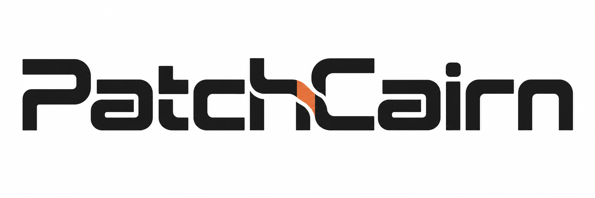
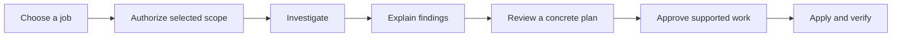

<p align="center">
  
</p>

<h1 align="center">A clearer path to a healthier computer.</h1>
<p align="center"><strong>Understand what needs attention. Choose what happens next.</strong></p>
<p align="center">A maintenance skillset for AI assistants, with local tools and clear explanations for people without an IT background.</p>
<p align="center"><strong>Developed by Michael</strong></p>
<p align="center"><a href="https://sacitdev.github.io/PatchCairn/">Website</a> · <a href="#get-started">Get started</a> · <a href="#four-jobs-one-careful-workflow">Four jobs</a> · <a href="#choose-your-level-of-involvement">Your choices</a> · <a href="#commands-you-can-use-in-chat">Commands</a> · <a href="#guides-and-reference">Guides</a></p>

---

PatchCairn helps a capable local AI assistant investigate your computer, explain its findings, and coordinate supported changes you approve. **Use its `PatchCairn:` requests in the assistant's chat.** The local CLI supports documented helper operations; it does not turn a chat request into a PowerShell, Bash, or Terminal command. The assistant keeps the technical records and brings the decisions to you in ordinary language.

The [documentation website](https://sacitdev.github.io/PatchCairn/) explains setup, the four jobs, and everyday use. Your computer's reports, private records, and operating controls stay local.

All four jobs belong to one PatchCairn project and use the same start. The public product version is recorded in [toolkit.json](toolkit.json); technical record-format identifiers describe internal components.

## Four jobs, one careful workflow

| I want to… | Choose | What to expect |
| --- | --- | --- |
| **Understand updates and security concerns** | Security updates | Check agreed software metadata, research official releases and advisories, distinguish compatibility questions from security findings, and propose specific updates. |
| **Find where space is going** | Storage cleanup | Measure folders you select, explain large items and possible duplicates, and review exact cleanup candidates. Matching files are a clue, not permission to delete. |
| **Investigate something that failed** | Diagnosis and repair | Gather relevant evidence, compare possible causes, explain confidence and uncertainty, then propose a justified repair and check its result. |
| **Protect files or recover a change** | Backup and recovery | Agree exact contents and exclusions, create and verify a bounded backup, and check the proposed restoration before changing the destination. |

Every job starts by clarifying scope. **Starting a session does not approve installations, deletions, repairs, restores, or restarts.**

## Get started

1. **Download and extract the complete source.** Use the source ZIP supplied by the publishing repository or its reviewed release, then extract it into a local folder you control. Keep the included `.agents` folder. Do not reuse someone else's `work/` records. The [setup guide](docs/GETTING_STARTED.md#1-download-and-extract-the-source) gives Windows, Linux, and macOS steps.
2. **Open that extracted folder in a local assistant.** Codex is the primary workflow. Claude Code, OpenCode, and other hosts need capability checks; their tools, permissions, and session behavior can differ. A browser chat cannot be assumed to control your computer. See [assistant compatibility](docs/ASSISTANT_COMPATIBILITY.md).
3. **Ask it to read the instructions.** Copy the message below into the assistant's chat, rather than an operating-system terminal.
4. **Choose a job and review the explanation.** The assistant describes what it will inspect and what stays private before assessment. Missing prerequisites or unsupported platform capabilities cause an explained hold.

> Read AGENTS.md and .agents/skills/pc-maintenance/SKILL.md from this project. PatchCairn: start. Show the menu and explain my choices in plain language. Wait until I select a job and authorize its scope before collecting information.

The opening identifies itself as **“PatchCairn — Developed by Michael”**, explains the four jobs, and offers the control style, checkpoints, timing, and commands. A bare “Start” or `PatchCairn: start` **shows the menu only**: it creates no session and collects no host information. Choosing a job creates its record; assessment begins only after you authorize the selected scope. You can also describe a problem in your own words; an ambiguous request needs a short clarification.

**Continue with:** [Your first run, step by step](docs/YOUR_FIRST_RUN.md) · [Setup guide](docs/GETTING_STARTED.md) · [Common questions](docs/FAQ.md)

## The route from a question to a verified result



In words: choose the job, agree the exact information or folders to inspect, investigate, understand the findings, review the concrete plan, choose the supported work, and check its actual result. Assessment is not approval for a later change. At a decision, expect benefits, drawbacks, known or unknown cost, recovery limits, and a recommendation.

An assessment can also finish with findings and no maintenance changes. For an eligible assessment-only session, the assistant records its findings and limitations, checks the evidence coverage separately, and records your actual closeout decision. Any selected finish checkpoint still waits for you. This completion records no maintenance action in that session; it does not certify the whole computer. If completion checks do not pass, the assistant explains the remaining work; you can stop and preserve the findings. It must never invent an action or mark deferred work complete to change the label.

You can say **“guided work now; pause after findings and before changes”**. Useful context is your goal, what you observed, which files or applications matter, what must stay available, and what must be kept. A short nonsecret error can help; passwords, raw logs, and private records should stay out of chat. You do not have to diagnose the problem or edit JSON.

## Choose your level of involvement

How work proceeds and when it begins are separate choices.

| Choice | Benefit | Tradeoff | Recommended starting point |
| --- | --- | --- | --- |
| **Guided** | Review explanations at your chosen checkpoints. | More pauses for your decisions. | Use for a first session, unfamiliar changes, and important files. |
| **Automatic within an approved policy** | Let unchanged, specifically authorized routine work continue. | Requires clear scope, limits, recovery requirements, and stop conditions. Protected decisions and uncertainty still cause a hold. | Use after reviewing the exact plan and choosing boundaries you trust. |
| **Now** | Begin the agreed work while you are available. | Work may interrupt an application or need a later restart decision. | Start with a read-only assessment. |
| **Scheduled** | Propose a later time for the agreed work. | The host must support scheduling and you must authorize schedule creation. A schedule grants no new maintenance permission. | Review the schedule and its exact scope before it is created. |

Choose checkpoints for scope, findings, the plan, before and after actions, and the finish. A restart is a separately explained decision when required. Settings changes do not expand an earlier approval.

At each real decision, expect **meaning, benefits, drawbacks, cost, reversibility, and a recommendation**. Cost can include assistant usage, downloads, storage, paid products, interruption, or your time. Unknown estimates remain unknown. A backup or rollback is described as available only after its relevant checks.

## Commands you can use in chat

Use the `PatchCairn:` prefix to keep these distinct from your assistant's own commands. You do not need to edit JSON or copy technical identifiers to manage a session.

| Command | What it does |
| --- | --- |
| `PatchCairn: start` | Show the menu without creating a session or collecting host information. Choose a job and authorize its scope separately. |
| `PatchCairn: help` | Explain the workflow and available commands. |
| `PatchCairn: status` | Explain the stage, completed work, holds, and next step. |
| `PatchCairn: options` | Show relevant choices and their practical consequences. |
| `PatchCairn: cost` | Report an estimate supported by known plan facts, including what is unknown. |
| `PatchCairn: settings` | Review scope, control style, checkpoints, and timing without widening old approvals. |
| `PatchCairn: pause` | Prevent new actions and bring active work to a safe checkpoint. |
| `PatchCairn: resume` | Reconcile actual outcomes and check freshness before continuing. |
| `PatchCairn: stop` | End further work while preserving records and unresolved items. |
| `PatchCairn: resolve` | Inspect an identified pending item and determine the evidence or choice it needs. |

Pause does not kill an installer during a write. Resume does not blindly repeat it. Resolve does not turn an unknown failure into success. The [workflow engine reference](docs/WORKFLOW_ENGINE.md) describes the deterministic local handlers and integration boundary.

## What a session feels like

The following is an illustration, not a report about a computer:

> **You:** I need more space, but I am worried about losing something.
>
> **PatchCairn:** We can first measure only the folders you choose. That will show where space is going without deleting files. If we find cleanup candidates, I will explain each choice and its recovery limits before you decide. I recommend starting with assessment.
>
> **You:** Pause before anything is moved.
>
> **PatchCairn:** I will stop at that checkpoint. Later cleanup will need a reviewed list of exact files and your approval.

The assistant keeps complete evidence in private local records and explains its practical meaning in chat. An attempted action, the expected version appearing, verified behavior, and a security concern being resolved remain separate facts.

## If something gets in the way

An interruption, full disk, missing tool or permission, changed file, unverified publisher, unsupported filesystem, or failed backup causes an explanation and a hold on dependent work. An unknown or partial result is investigated; it is not retried blindly. Pause reaches a safe checkpoint, resume needs fresh actual-state checks, and stop preserves unfinished work while ending the session.

Read [your first-run guide](docs/YOUR_FIRST_RUN.md#common-interruptions-and-difficult-cases) for practical choices, costs, and recovery limits in each case. Authentication, OS consent, missing required recovery, stale evidence, and material scope changes never become automatic.

For storage, quarantine on the same volume frees **no disk space**. Permanent removal needs its own reviewed decision and exact verified original recovery coverage; unbacked quarantine can be reviewed for restoration while integrated purge stays held. The selected content-backup route has **16 MiB/file, 48 MiB total content, and 64 MiB archive** caps. Current integrated update handoffs accept exact reviewed local **MSI, PKG, or DEB** artifacts up to **64 MiB**; package-manager updates and OS/application repair routes remain held. The assistant can explain a separately reviewed official procedure, but that explanation does not supply a missing execution adapter or prove a change occurred. [Current scope and alternatives](docs/YOUR_FIRST_RUN.md#know-the-current-boundaries-before-committing).

## Your control and privacy

- **Agree scope first.** Selected metadata and folders guide the work. Browser history, cookies, profiles, passwords, chat sessions, credentials, and unrelated projects are excluded from cleanup and broad discovery.
- **Approve a concrete change.** The plan names the target, source, impact, recovery limits, verification, and restart policy. The assistant records your actual decision; an imported approval flag does not authorize work.
- **Keep protected decisions yours.** Authentication, operating-system consent, material scope changes, and separately required restart choices remain explicit.
- **Keep local records local.** Session files belong under `work/`. Public source and websites must exclude private records. Deleting records does not undo updates or erase the operating system's own logs.
- **Understand a hold.** Missing capabilities, stale evidence, uncertain outcomes, and unavailable required recovery stop the dependent action. The workflow is not an antivirus or a guarantee that every issue is found.

Read the [security contract](SECURITY.md) and [recovery and cleanup guide](RECOVERY_AND_CLEANUP.md) for the exact boundaries.

## Guides and reference

| I want to… | Read |
| --- | --- |
| Start my first session | [Getting started](docs/GETTING_STARTED.md) |
| Follow the journey and handle interruptions | [Your first run](docs/YOUR_FIRST_RUN.md) |
| Understand choices, costs, and pauses | [Frequently asked questions](docs/FAQ.md) |
| Check tools and supported scope | [Platform notes](docs/PLATFORM_SUPPORT.md) and [official tool catalog](docs/TOOLS.md) |
| Inspect commands and durable sessions | [Workflow engine](docs/WORKFLOW_ENGINE.md) |
| Inspect how reviewed actions reach fixed adapters | [Service integration](docs/SERVICE_INTEGRATION.md) |
| Understand storage and backup operations | [Storage and backup API](docs/STORAGE_BACKUP_API.md) |
| Understand bounded diagnostics | [Diagnostic API](docs/DIAGNOSTIC_API.md) and [diagnosis example](docs/DIAGNOSIS_EXAMPLE.md) |
| Inspect records and architecture | [Architecture](docs/ARCHITECTURE.md) and [helper API](references/HELPER_API.md) |
| Contribute a fix or fictional example | [Contributing](docs/CONTRIBUTING.md) |
| Prepare GitHub and Pages publication | [GitHub setup](docs/GITHUB_SETUP.md) and [UTC publication guide](docs/UTC_PUBLICATION.md) |

Windows's existing record helpers use PowerShell. The portable conversation and storage helpers require an existing supported Python 3.12+ and use its standard library. The assistant checks actual host capabilities before choosing an adapter. Native platform and hosted CI claims belong to the [documented validation evidence](docs/PLATFORM_SUPPORT.md).

## Documentation website

The static site shares the approved wordmark and public guides with this README. Its resources are self-hosted: no external fonts, third-party scripts, trackers, live reports, or maintenance controls. A fixed local `enhancements.js` provides visual effects and hover/focus cues only; reading the guides does not require JavaScript. Examples are illustrative.

Build a preview from the source root with an existing Python 3.12+:

```text
python -I -S -B scripts/build_site.py --output work/site/preview
```

Open the generated `index.html` in a browser. The builder accepts only a reviewed list of public files and writes beneath `work/site/`. The included GitHub Pages workflow runs manually from the default branch and publishes only its generated `work/site/github-pages` output. The site builder receives the repository link during publication, so forks can supply their own destination. See [GitHub setup](docs/GITHUB_SETUP.md).

## License

PatchCairn's source is licensed under the [MIT License](LICENSE), copyright 2026 Michael. The license grants permission to use, copy, modify, and distribute the source subject to its terms. It does not approve access to a computer or replace the exact maintenance decisions described above.
