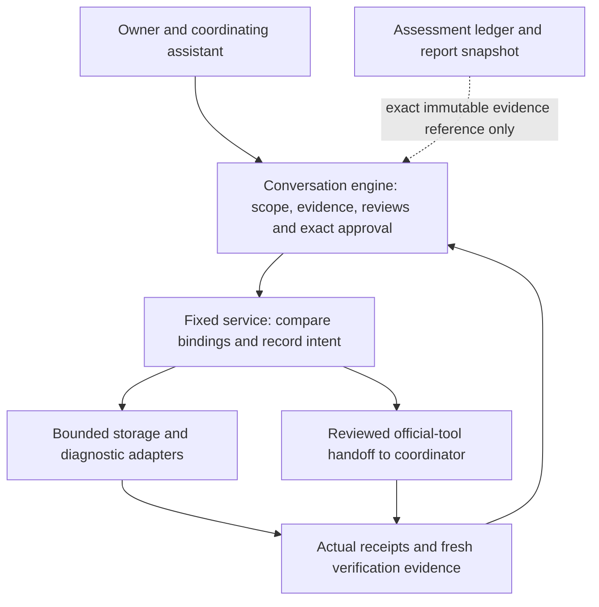

# Architecture and operating boundaries

PatchCairn combines public job skills, a deterministic conversation/session engine, and fixed local service adapters. The assistant coordinates actual owner decisions, current research, supported tools and outcome verification. These records and helpers do not grant OS privileges, authenticate a human from JSON, or provide a universal maintenance executor.

There is one product version in `toolkit.json` and one current conversation entrypoint. The stores and helpers below are components of that product. Numbers in exact schema/backend identifiers and storage paths are internal record-format names; they do not offer alternative product versions or authorize data migration.

Read the [working agreement](../AGENTS.md), [router](../.agents/skills/pc-maintenance/SKILL.md) and [communication guide](../references/COMMUNICATION.md) before operating the toolkit. Opening the project, displaying the menu or creating a session authorizes no host collection or change.

## Conversation, state and execution

`scripts/workflow_core.py` validates conversation sessions and implements fixed command handlers. `scripts/patchcairn_workflow.py` supplies human terminal output; its no-argument or bare-start menu creates no session. `templates/workflows.json` and `templates/session-contract.json` describe the public contract. Executable code still enforces schemas, stage checks and adapter allowlists; editing a template cannot extend them.

Human output begins **PatchCairn — Developed by Michael** and presents the four jobs, guided/automatic control, independent now/scheduled timing, selectable checkpoints, privacy limits and all commands. Commands use `PatchCairn: start`, `help`, `status`, `options`, `cost`, `settings`, `pause`, `resume`, `stop` and `resolve`. Host slash commands retain their host meaning. Validated state and fixed templates produce explanations; JSON envelopes, IDs and hashes are internal bookkeeping rather than a user editing interface. Decision cards explain meaning, benefits, drawbacks, known or unknown costs, reversibility and a recommendation.

| Job | Stage sequence |
| --- | --- |
| Security and updates (`security_updates`) | Scope → inventory → research → plan → apply → verify → complete |
| Storage and cleanup (`storage_cleanup`) | Scope → inventory → candidates → plan → apply → verify → complete |
| Diagnosis and repair (`diagnosis_repair`) | Scope → symptom → hypotheses → plan → apply → verify → complete |
| Backup and recovery (`backup_recovery`) | Scope → inventory → recovery plan → plan → apply → verify → complete |

Each stage requires owned current-scope evidence of its specific checks. A stage label or narrative cannot establish a completed inventory, supported diagnosis, successful operation or verified recovery. See the [workflow engine guide](WORKFLOW_ENGINE.md) for exact signatures, fields and freshness rules.

## Separate record stores

| Store | Canonical purpose and boundary |
| --- | --- |
| Conversation workflow, normally `work/sessions/` | Engine identity in `work/sessions/engine.json`, immutable session creation marker and atomically replaced `work/sessions/<session_id>/session.json` containing validated state plus revision/hash-linked events. There is no extra nested sessions directory. Creation backend, engine, mode, platform, job, owner and original scope binding remain distinct from later versioned settings. Missing or foreign state refuses rather than silently recreating it; records at a previous default path are not adopted, migrated or deleted. |
| Fixed-adapter service, normally `work/services/` | Service-to-engine identity, immutable complete operation intents, effect-boundary/handoff records, native-origin bindings and protected recovery retention. It does not replace engine state or adopt, migrate or delete a previous namespace. |
| Diagnostic store, normally `work/diagnostics/` or the service's bound diagnostic child | Immutable requests, results, selected excerpts, hypotheses and verification with actual byte hashes, scope and UTC observations. Engine integration registers a separate exact evidence copy. A path is a reference, not authority to read another file. Previous namespaces are not automatically adopted, migrated or deleted. |
| Storage output | Exact selected inventories/plans, immutable archives/manifests, attempts, numbered progress mappings, outcomes and restoration proof under the reviewed owned output root. All are private evidence or recovery data. |
| Windows native worker transport, `work/windows-scoped/` | Private `worker-<generation>/` fixed source snapshots/compiler files and exclusive `request-<id>/request.json` plus `response.json` per logical operation. These content-bearing packets are separate from canonical approval/intent/attempt/step/outcome records. Recycling or shutdown deletes none of them, and assessment-run cleanup does not automatically own them. |
| Assessment-record Python and PowerShell assessment runs | Existing `ledger.json`, `actions.jsonl`, `PLANS.md`, backend/run markers and `owned-files.json` retain their own contracts. They are not conversation sessions and must not be promoted or edited into a new backend. |
| Assessment-record HTML/CSV/JavaScript views | Reports derive from one immutable assessment-record ledger byte snapshot. Embedded JavaScript filters and renders that snapshot; it is not another canonical ledger, an approval channel or a local execution bridge. |

The assessment-record contract is [LEDGER_SPEC.md](../LEDGER_SPEC.md) and `templates/ledger-contract.json`. Its Windows PowerShell and Python backends retain distinct native and ownership rules. Record housekeeping and selected-root storage cleanup are separate component operations: a checked quarantine does not add quarantine capability to POSIX record deletion.

A verified immutable reference can connect relevant assessment-record or diagnostic evidence to a conversation session after the coordinator checks identity, bytes, scope and meaning. There is no automatic migration, cross-backend approval, fixture-to-real promotion or reuse of another computer's facts. Escaped HTML and spreadsheet-prefix handling protect derived presentation; reports remain outputs and never supply executable instructions or consent.

## Exact plan, service and native gates

One coordinator owns canonical state, evidence registration, artifact bookkeeping, host changes and UI input. Independent workers return bounded findings and reviews; they do not race session files or invoke mutations. [Agents and decisions](../references/AGENTS_AND_DECISIONS.md) defines this process.

The coordinator establishes current scope authority and prepares the fixed adapter payload. Every action binds its exact kind/ID to `adapter_id`, `adapter_payload_evidence_id`, `adapter_payload_sha256`, `adapter_plan_sha256`, `target_inventory_evidence_id` and `target_inventory_sha256`. The lower-level storage plan, diagnostic request or external plan is owned evidence, not a free-form function name. Approval also binds the actual owner's message to the engine plan hash, selected action IDs, current scope and settings revision. Two distinct independent reviewers assess that same plan under `compatibility_data` and `evidence_security`; their passes supply no owner consent.

Before the effect, the service rereads registered bytes and checks fixed adapter/kind, plan/inventory hashes, creation mode/platform, source scope, owned output and recovery protections. Storage `check_preconditions` inspects actual selected files and outputs before `begin_operation`; native read/move/remove checks fresh identity/content again at its boundary. Action-specific preconditions also bind compatibility, provenance, content, scope and required recovery. Protected OS consent is separately recorded when required. Stale or contradictory bindings hold.

A successful `begin_operation` durably consumes one exact action and supplies its operation ID. The service records complete immutable intent before invoking the fixed adapter and checks whether pause/stop arrived before the first effect. Actual outcome evidence finishes the operation as succeeded, failed, partial or unknown. Consumed action IDs are never replayed, even after failure. Tool exit, verified installation, original behavior and security remediation remain separate facts.

Hashes detect changed bytes; they cannot prove that a quotation is authentic or an observation is true. Libraries have their calling process's authority. Direct calls, a claimed quiet workspace and imported `approved=true` do not establish human consent. The supported assistant/coordinator must apply the gate; records are not an OS sandbox.

## Fixed adapters and external operations

`scripts/workflow_service.py` connects the engine to five fixed storage operations: backup creation/restoration, quarantine/restoration and separate permanent purge. `diagnostic.read_recipe.v3` accepts only documented enumerated metadata recipes. The inspection CLI `scripts/patchcairn_service.py` exposes catalog/status/operation inspection, with no imported-plan or mutation command. See [service integration](SERVICE_INTEGRATION.md), [storage API](STORAGE_BACKUP_API.md) and [diagnostic API](DIAGNOSTIC_API.md).

`system.reviewed_external.v3` currently supports only three fixed local-artifact update handoffs: `windows.msiexec.install` for one exact owned `.msi`, `macos.installer.pkg` for one exact owned `.pkg`, and `linux.dpkg.install_local` for one exact owned `.deb`. Fresh preflight binds that staged path and native identity/content to the reviewed package identity, version, stable channel, architecture, installation scope, publisher and source, with actual selected metadata and publisher/signature evidence. Fixed literal arguments must consume that same artifact. Package-manager upgrade handoffs remain held because their transaction cannot be bound to those exact staged bytes. OS/application component repair handoffs also remain held until supported typed recovery covers the exact component; ordinary file-content ZIP/probe evidence is not OS or package-state rollback. Unknown catalogs, extra flags, changed artifacts or missing capabilities hold. A catalog entry establishes neither installation nor authority on this host.

The assistant performs the reviewed call through its available host tool and normal OS permissions, then supplies a matching actual receipt and fresh evidence. The service does not execute shell text or data-selected executables, perform arbitrary GUI input, install prerequisites, bypass authentication or infer success from handing back a plan. Unsupported routes remain held. Native UI needs a current host computer-use skill and supported tool. See [host compatibility](ASSISTANT_COMPATIBILITY.md).

## Storage, recovery and interruption

Storage starts with explicit selected roots and metadata. Ordinary-file hashing/archive reads need distinct content-read authority. Browser, credential, session, system and unrelated data stay excluded without opening them. Duplicate bytes and logical sizes establish neither removability nor physical free-space gain.

The [selected-root filesystem adapter](SCOPED_FILESYSTEM.md) refuses links/reparses, unsupported filesystems, hard links, stale identity/content, occupied destinations and missing native capabilities. Windows uses checked handles on the supported local NTFS route; POSIX uses pinned descriptors and native no-overwrite rename only where available. There is no cross-volume copy/delete, overwrite, force, recursive host-cleaning or permission-repair fallback. A quiet owner-controlled workspace is required. Individual operations do not guarantee multi-file transactions, protection against malicious same-user/privileged tampering, power-loss recovery or automatic rollback.

The Windows adapter uses a lazy process-owned serial PowerShell worker through `windows_worker.py`, compiling the fixed C# source once per exact source/runtime/private-root generation. Each request uses a fresh function scope; selected-file operations create fresh C# `Scope` objects and repeat current selected-root/file/hash checks and applicable privacy admission; selected handles, results and authority are not cached. The supported worker route requires Windows 10+/Server 2016+, 64-bit Python and 64-bit `FullLanguage` PowerShell. Atomic owned-job launch and inherited anonymous pipes provide a helper-lifetime boundary, not new host authority. POSIX adapters and higher-level approval/receipt contracts are unchanged.

A possible-send transport/protocol/persistence ambiguity preserves unknown effects and is never resent through a replacement or one-shot helper. Replacement waits for observed owned-job and I/O teardown; unresolved teardown retains the required pins and holds. Caller serialization has a separate wait of up to 120 seconds, followed after admission by one 120-second cold-startup/send/reply budget plus separate five-second failure-teardown grace; private file I/O prevents a hard total-return promise. Explicit `windows_scoped.shutdown_worker()` proves a point-in-time owned-helper drain without deleting files or closing user apps; later native calls can start another generation. An embedding process must complete shutdown before updating the selected PowerShell runtime or toolkit PS/C# sources. The coordinator must keep toolkit native calls quiet through that update or an external-installer interval and repeat the drain after later native preflight. See [worker lifecycle](WINDOWS_ADAPTER.md#owned-serial-worker-lifecycle) for serial-call, generation and shutdown limits.

Required recovery binds exact archive/manifest identities and hashes, a completed restoration outcome and reread restored file bytes. Service retention protects those artifacts and restored probes before later cleanup. Boolean declarations are insufficient. A reviewed backup can include an exact fresh restoration-probe destination as its verification substep; it cannot request arbitrary nested operations. Purge has a separate exact plan and plan/action-bound irreversible-loss acknowledgment. Quarantine approval covers no purge, and automatic settings cannot waive required recovery.

Pause prevents new actions immediately while active work reaches a supported safe checkpoint; it does not kill an installer. Resume requires fresh scope/outcome reconciliation. Stop is terminal: it accepts only exact eventual receipts or bounded accounting for existing unresolved effects, without a new job plan, action, ticket or resume. For a retained unfinished MSI3010 operation, a fresh actual owner defer/authorize decision can cover only its exact owner-handled restart and observed continuation, even after stop. The session stays stopped. `resolve` cannot declare unknown work fixed. Failed/partial outcomes remain historical; their effects need fresh actual/no-active-work/retained-recovery reconciliation before eligible replanning, with new independent review and actual approval. An outstanding mutating operation blocks new mutation and schedule dispatch across the same engine registry until its actual receipt or effects reconciliation is recorded; this engine-local gate is not a global OS lock.

Scheduled timing stores a proposal, not an OS task. Due/expiry/catch-up checks, unique trigger IDs and active-job coordination prevent early, late or duplicate starts; triggers cannot reopen paused, held or stopped work. An actual host schedule needs a supported scheduler, exact action and owner authority. Control style remains independent. Bounded standing policies must match supported exact reviewed bindings; settings changes invalidate affected scope/plan/review/approval assumptions.

## Validation and privacy limits

All generated sessions, evidence, tests, downloads, recovery records, reports and exports belong under owned `work/`. Source publication uses an exact allowlist and excludes private work, host state and `.git/`; the public site is documentation only. Vendor tools, operating systems and assistant hosts may keep normal records elsewhere. Deleting toolkit work neither reverses an update nor erases external records.

Current storage caps are 10,000 metadata entries/depth 48, 16 MiB per selected file, 48 MiB selected content and 64 MiB per archive. A verified ZIP is local selected file-content recovery. Original ACLs, extended attributes, ownership, timestamps, sparse allocation, executable semantics, empty directories, encryption and off-device disaster recovery are not promised. Larger tasks require narrower supported scope or another separately reviewed tool; increased constants do not establish a safe streaming design.

Tests use fictional owned data, exercise meaningful gates and record actual skips. Local Windows Python 3.14 fixture discovery completed 523 cases: 471 passed, 52 skipped, no failures or errors, with the tested source unchanged. Focused Windows NTFS fixtures also created, inspected and read 64 MiB under PowerShell 7 and Windows PowerShell 5.1, verified bytes/hashes, and completed owned-worker teardown. The counts, observed worker process lifetime peaks and resource limits are described in [Windows evidence](WINDOWS_ADAPTER.md#evidence-and-test-limits); neither suite completion nor the focused checks establish general workload speed. Hosted Ubuntu and macOS ARM64 runs have exercised native operations on fictional owned files, including checked reads, exclusive creation, quarantine/restoration, exact purge, backup verification and service recovery records; see the source-bound [platform evidence](PLATFORM_SUPPORT.md#hosted-fixture-evidence). Mocked diagnostic/installer contracts and a checked-in CI matrix do not establish live collection, installation or broader platform support. Provider startup comparisons cover only the stated first response. Read [platform support](PLATFORM_SUPPORT.md), [Windows limits](WINDOWS_ADAPTER.md) and the relevant helper guide before claiming native support or verification.
