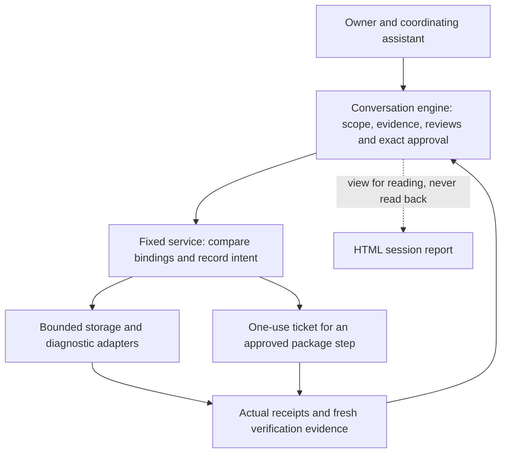

# Architecture and operating boundaries

PatchCairn combines public job skills, a deterministic conversation/session engine, and fixed local service adapters. The assistant coordinates actual owner decisions, current research, supported tools and outcome verification. These records and helpers do not grant OS privileges, authenticate a human from JSON, or provide a universal maintenance executor.

There is one product version in `toolkit.json` and one current conversation entrypoint. The stores and helpers below are components of that product. Schema/backend identifiers and storage paths are unversioned internal record names (each record also carries the integer `schema_version` 1); they do not offer alternative product versions or authorize data migration.

Read the [working agreement](../AGENTS.md), [router](../.agents/skills/pc-maintenance/SKILL.md) and [communication guide](../references/COMMUNICATION.md) before operating the toolkit. Opening the project, displaying the menu or creating a session authorizes no host collection or change.

## Conversation, state and execution

`scripts/workflow_core.py` validates conversation sessions and implements fixed command handlers. `scripts/patchcairn_workflow.py` supplies human terminal output; its no-argument or bare-start menu creates no session. `templates/workflows.json` describes the public contract. Executable code still enforces schemas, stage checks and adapter allowlists; editing a template cannot extend them.

Human output begins **PatchCairn — Developed by Michael** and presents the four jobs, guided/automatic control, independent now/scheduled timing, selectable checkpoints, privacy limits and all commands. Commands use `PatchCairn: start`, `help`, `status`, `options`, `cost`, `settings`, `pause`, `resume`, `stop` and `resolve`. Host slash commands retain their host meaning. Validated state and fixed templates produce explanations; JSON envelopes, IDs and hashes are internal bookkeeping rather than a user editing interface. Decision cards explain meaning, benefits, drawbacks, known or unknown costs, reversibility and a recommendation.

| Job | Stage sequence |
| --- | --- |
| Security and updates (`security_updates`) | Scope → inventory → research → plan → apply → verify → complete |
| Storage and cleanup (`storage_cleanup`) | Scope → inventory → candidates → plan → apply → verify → complete |
| Diagnosis and repair (`diagnosis_repair`) | Scope → symptom → hypotheses → plan → apply → verify → complete |
| Backup and recovery (`backup_recovery`) | Scope → inventory → recovery plan → plan → apply → verify → complete |

Each stage requires owned current-scope evidence of its specific checks. A stage label or narrative cannot establish a completed inventory, supported diagnosis, successful operation or verified recovery. See the [workflow engine guide](WORKFLOW_ENGINE.md) for exact signatures, fields and freshness rules.

## Separate record stores

| Store | Canonical purpose and boundary |
| --- | --- |
| Conversation workflow, normally `work/sessions/` | Engine identity in `work/sessions/engine.json`, immutable session creation marker and atomically replaced `work/sessions/<session_id>/session.json` containing validated state plus revision/hash-linked events. There is no extra nested sessions directory. Creation backend, engine, mode, platform, job, owner and original scope binding remain distinct from later versioned settings. Missing or foreign state refuses rather than silently recreating it; records at a previous default path are not adopted, migrated or deleted. |
| Fixed-adapter service, normally `work/services/` | Service-to-engine identity, immutable complete operation intents, effect-boundary and ticket records, native-origin bindings and protected recovery retention. It does not replace engine state or adopt, migrate or delete a previous namespace. |
| Diagnostic store, normally `work/diagnostics/` or the service's bound diagnostic child | Immutable requests, results, selected excerpts, hypotheses and verification with actual byte hashes, scope and UTC observations. Engine integration registers a separate exact evidence copy. A path is a reference, not authority to read another file. Previous namespaces are not automatically adopted, migrated or deleted. |
| Storage output | Exact selected inventories/plans, immutable archives/manifests, attempts, numbered progress mappings, outcomes and restoration proof under the reviewed owned output root. All are private evidence or recovery data. |
| Package tickets and run folders, `work/services/tickets/` and `work/package-runs/` | One one-use ticket per begun package operation, binding its run folder and run files; a fresh private run folder for each manager read or run. A ticket runs once; the check after a restart reuses its launcher command. |
| HTML session report, `work/services/reports/` | Built from one session record by `python -I -S -B scripts/patchcairn_service.py report <session>`. Embedded JavaScript filters and renders that snapshot; the report is not another canonical record, an approval channel or a local execution bridge, and PatchCairn never reads it back. |

The service's retention registry names every kept backup, quarantine set, recovery binding and chosen backup destination. Kept files are deleted only through a reviewed retention release (`storage.retention_release` or `storage.session_release`), never by selected-root host cleanup; a checked quarantine does not add deletion capability to a release.

A verified immutable reference can connect relevant diagnostic evidence to a conversation session after the coordinator checks identity, bytes, scope and meaning. There is no automatic migration, cross-backend approval, fixture-to-real promotion or reuse of another computer's facts. Escaped HTML protects derived presentation; reports remain outputs and never supply executable instructions or consent.

## Exact plan, service and native gates

One coordinator owns canonical state, evidence registration, artifact bookkeeping, host changes and UI input. Independent workers return bounded findings and reviews; they do not race session files or invoke mutations. [Agents and decisions](../references/AGENTS_AND_DECISIONS.md) defines this process.

The coordinator establishes current scope authority and prepares the fixed adapter payload. Every action binds its exact kind/ID to `adapter_id`, `adapter_payload_evidence_id`, `adapter_payload_sha256`, `adapter_plan_sha256`, `target_inventory_evidence_id` and `target_inventory_sha256`. The lower-level storage plan, diagnostic request or package payload is owned evidence, not a free-form function name. Approval also binds the actual owner's message to the engine plan hash, selected action IDs, current scope and settings revision. Two distinct independent reviewers assess that same plan under `compatibility_data` and `evidence_security`; their passes supply no owner consent.

Before the effect, the service rereads registered bytes and checks fixed adapter/kind, plan/inventory hashes, creation mode/platform, source scope, owned output and recovery protections. Storage `check_preconditions` inspects actual selected files and outputs before `begin_operation`; native read/move/remove checks fresh identity/content again at its boundary. Action-specific preconditions also bind compatibility, provenance, content, scope and required recovery. Operating-system consent is recorded after the run, from what the run observed; no consent record is taken before it. Stale or contradictory bindings hold.

A successful `begin_operation` durably consumes one exact action and supplies its operation ID. The service records complete immutable intent before invoking the fixed adapter, and the engine's last admission (`admit_effect`) right before the first effect sees any pause or stop that arrived first. Actual outcome evidence finishes the operation as succeeded, failed, partial or unknown. Consumed action IDs are never replayed, even after failure. Tool exit, verified installation, original behavior and security remediation remain separate facts.

Hashes detect changed bytes; they cannot prove that a quotation is authentic or an observation is true. Libraries have their calling process's authority. Direct calls, a claimed quiet workspace and imported `approved=true` do not establish human consent. The supported assistant/coordinator must apply the gate; records are not an OS sandbox.

## Fixed adapters and external operations

`scripts/workflow_service.py` connects the engine to fixed storage operations: backup creation/restoration, quarantine/restoration, separate permanent purge, and the release or forgetting of kept backups. `diagnostic.collect` accepts only documented enumerated metadata recipes. The service CLI `scripts/patchcairn_service.py` exposes catalog/status/operation inspection, the session report, the kept-recovery listing and the ticket-bound launcher; it has no imported-plan command. See [service integration](SERVICE_INTEGRATION.md), [storage API](STORAGE_BACKUP_API.md) and [diagnostic API](DIAGNOSTIC_API.md).

Updates and repairs use the built package routes: winget (Windows), Homebrew (macOS), and apt and dnf5 (Linux). `discover_packages` reads what the manager offers through fixed read-only commands; `prepare_package_action` binds the exact package, version, source, dependencies, executable and arguments into a `patchcairn.package` payload. Every argument a route may pass is an allowed row of a reviewed token table. Repairs are a same-version reinstall (Homebrew, apt, dnf) or finishing an interrupted dpkg setup; DISM repair holds, and System File Checker and winget repair are guidance only. Windows Update, macOS Software Update, firmware, Python and Node packages have no built route in this version. Unknown managers, extra flags, changed offers or missing capabilities hold. A route existing establishes neither installation nor authority on this host.

After approval, `execute_action` begins the operation and writes a one-use ticket. Only the ticket's `command` exactly as `execute_action` returns it (`python -I -S -B scripts/patchcairn_service.py run --ticket <ticket>`, already quoted for this shell) runs that step: it refuses while PatchCairn has administrator rights, checks the binding and the offer again, passes the engine's last admission, and starts exactly the bound executable with the bound arguments, without a shell. A terminal step (apt, dnf) is pasted by the owner into their own Terminal. The result is then read afresh. The service does not execute shell text or data-selected executables, perform arbitrary GUI input, install prerequisites, bypass authentication or infer success from a launch. Unsupported routes remain held. Native UI needs a current host computer-use skill and supported tool. See [host compatibility](ASSISTANT_COMPATIBILITY.md).

## Storage, recovery and interruption

Storage starts with explicit selected roots and metadata. Ordinary-file hashing/archive reads need distinct content-read authority. Browser, credential, session, system and unrelated data stay excluded without opening them. Duplicate bytes and logical sizes establish neither removability nor physical free-space gain.

The [selected-root filesystem adapter](SCOPED_FILESYSTEM.md) refuses links/reparses, unsupported filesystems, hard links, stale identity/content, occupied destinations and missing native capabilities. Windows uses checked handles on the supported local NTFS route; POSIX uses pinned descriptors and native no-overwrite rename only where available. There is no cross-volume copy/delete, overwrite, force, recursive host-cleaning or permission-repair fallback. A quiet owner-controlled workspace is required. Individual operations do not guarantee multi-file transactions, protection against malicious same-user/privileged tampering, power-loss recovery or automatic rollback.

The Windows adapter runs in the Python process: `windows_scoped.py` calls Windows through `win32_files.py` (`ctypes`) and needs 64-bit Python 3.12+. Each open root has its own I/O thread, which holds the selected root and its ancestors open for the root's lifetime and opens each selected file per operation; selected-file operations repeat current selected-root/file/hash checks and applicable privacy admission, and no authority is cached. POSIX adapters and higher-level approval/receipt contracts are unchanged.

Each Windows native call has a deadline (120 seconds, plus flush time for a new file). A call that does not return in time is cancelled with `CancelSynchronousIo` and reported as unresolved; its effects stay unknown, the root refuses later calls, and nothing is resent. See [the I/O thread lifecycle](WINDOWS_ADAPTER.md#io-thread-lifecycle) for the exact limits.

Required recovery binds exact archive/manifest identities and hashes, a completed restoration outcome and reread restored file bytes. Service retention protects those artifacts and restored probes before later cleanup. Boolean declarations are insufficient. A reviewed backup can include an exact fresh restoration-probe destination as its verification substep; it cannot request arbitrary nested operations. Purge has a separate exact plan. After both reviews the engine issues its warning with the number of files and bytes (`issue_irreversible_warning`), and only the owner's typed reply of the exact phrase, such as "delete 12 files", approves it; the record shows that the engine received the phrase, not who typed it, so it catches reuse, not forgery. Quarantine approval covers no purge, and automatic settings cannot waive required recovery.

Pause prevents new actions immediately while active work reaches a supported safe checkpoint; it does not kill an installer. Resume requires fresh scope/outcome reconciliation. Stop is terminal: it accepts only exact eventual receipts or bounded accounting for existing unresolved effects, without a new job plan, action, ticket or resume. A step whose route reports that a restart is needed stays open in the restart class until a boot later than the step is observed; no other change can start meanwhile except a backup, and PatchCairn never restarts the computer. A stopped session still accounts for such a step and stays stopped. `resolve` cannot declare unknown work fixed. Failed/partial outcomes remain historical; their effects need fresh actual/no-active-work/retained-recovery reconciliation before eligible replanning, with new independent review and actual approval. An outstanding mutating operation blocks new mutation and schedule dispatch across the same engine registry until its actual receipt or effects reconciliation is recorded; this engine-local gate is not a global OS lock.

Scheduled timing stores a proposal, not an OS task. Due/expiry/catch-up checks, unique trigger IDs and active-job coordination prevent early, late or duplicate starts; triggers cannot reopen paused, held or stopped work. An actual host schedule needs a supported scheduler, exact action and owner authority. Control style remains independent. Bounded standing policies must match supported exact reviewed bindings; settings changes invalidate affected scope/plan/review/approval assumptions.

## Validation and privacy limits

All generated sessions, evidence, tests, downloads, recovery records and reports belong under owned `work/`; a backup may instead go to a folder the owner chose on another drive. Published source excludes private work, host state and `.git/`; the public site is documentation only. Vendor tools, operating systems and assistant hosts may keep normal records elsewhere. Deleting toolkit work neither reverses an update nor erases external records.

Current storage caps are 100,000 metadata entries and depth 48; duplicate comparison and quarantine read at most 16 MiB per file and 48 MiB in total. A backup streams up to 100,000 files to the owned work folder or a chosen folder on another drive, and PatchCairn's restore reads at most a 32 MiB archive and 16 MiB per file. A verified ZIP is local selected file-content recovery. Original ACLs, extended attributes, ownership, timestamps, sparse allocation, executable semantics, empty directories, encryption and off-device disaster recovery are not promised. Larger tasks require narrower supported scope or another separately reviewed tool.

Tests use fictional owned data, exercise meaningful gates and record actual skips. This page records no test counts; results of the published source are those of its completed CI run, described in [platform evidence](PLATFORM_SUPPORT.md#hosted-fixture-evidence). Mocked diagnostic and package-manager contracts and a checked-in CI matrix do not establish live collection, installation or broader platform support. Provider startup comparisons cover only the stated first response. Read [platform support](PLATFORM_SUPPORT.md), [Windows limits](WINDOWS_ADAPTER.md) and the relevant helper guide before claiming native support or verification.
