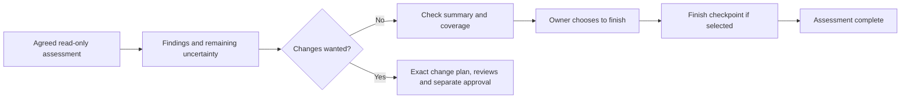

# Conversation and session engine

PatchCairn's conversation engine keeps four jobs in durable, validated sessions and explains the next decision in ordinary language. It records and gates work; the coordinator invokes separately implemented, fixed supported adapters. It never executes command text from a plan or creates an operating-system schedule. Start with the one standard job menu; backend and schema identifiers below are internal record bindings.

The opening message begins **PatchCairn — Developed by Michael**. It describes four numbered choices: security and updates, storage and cleanup, diagnosis and repair, and backup and recovery. Guided or automatic control is independent of now or scheduled timing. Automatic control alone grants no authority. A bare start displays this menu and creates no session. Choosing a job creates its record and requires a separate current-owner scope decision before the workflow advances.

## Human interface

Run the following with an existing supported Python 3.12 or newer installation. The script derives the repository root from its own location. Isolated execution with no site packages or bytecode is supported:

```text
python -I -S -B scripts/patchcairn_workflow.py
python -I -S -B scripts/patchcairn_workflow.py start storage_cleanup --control guided --timing now --scope selected-folder
python -I -S -B scripts/patchcairn_workflow.py status --session session-IDENTIFIER
python -I -S -B scripts/patchcairn_workflow.py settings control=automatic --session session-IDENTIFIER
```

`--json` returns an internal structured response envelope. People use chat or human terminal output; they do not edit JSON to approve work. Fixture mode is the CLI default: when the person chooses a job, the assistant adds `--mode real` to the same command, because without it the choice (for example a bare `1`) opens a practice session that never reads or changes the computer. `--mode real` creates a separate real session record, and does not authorize collection, install prerequisites, promote a fixture or perform a computer change. The human output ends with a `Session:` line and, when a step waits for its check after a restart, an `Operation:` line; `scripts/patchcairn_service.py inspect-operation <session> <operation>` prints the command for that check.

| Command | Meaning |
| --- | --- |
| `PatchCairn: start` | Show the menu without allocating a session. Choose job 1–4, a supported friendly job phrase, or an internal exact identifier to create that job's assessment record. |
| `PatchCairn: help` | Explain jobs, controls, checkpoints, privacy and commands. |
| `PatchCairn: status` | Explain the current job, stage, holds and actual operation outcomes. |
| `PatchCairn: options` | Present meaning, benefits, drawbacks, cost, reversibility, recommendation and choices. |
| `PatchCairn: cost` | Use owned current action-specific inventory facts; missing costs stay unknown. |
| `PatchCairn: settings` | Explain or adjust independent control, timing and selected checkpoints. |
| `PatchCairn: pause` | Block new actions immediately; preserve an active operation until its safe receipt. |
| `PatchCairn: resume` | Request fresh current-scope and actual-outcome reconciliation through the coordinator. Text alone cannot resume work. |
| `PatchCairn: stop` | Close the session and preserve evidence and unfinished work. An eventual active-operation receipt can still be recorded. |
| `PatchCairn: resolve` | Inspect a specific pending decision or bounded reconciliation; never declare unsupported success or retry an action. |

These names belong to PatchCairn. Host slash commands such as `/resume` are rejected. A small fixed natural-language mapping accepts unambiguous requests such as `start assessment`; other unknown or ambiguous text returns an explicit clarification. There is no generic method-name or command-string dispatch.

## Jobs and checkpoints

| Job | Stages |
| --- | --- |
| `security_updates` | Scope → inventory → research → plan → apply → verify → complete |
| `storage_cleanup` | Scope → inventory → candidates → plan → apply → verify → complete |
| `diagnosis_repair` | Scope → symptom → hypotheses → plan → apply → verify → complete |
| `backup_recovery` | Scope → inventory → recovery plan → plan → apply → verify → complete |

Every stage needs owned current-scope evidence of its specific checks. For example, inventory needs a completed assessment and an explicit item count; hypotheses need considered alternatives and distinguishing checks. Apply needs an actual successful receipt for every exact planned action. Verification requires new observations after the operation receipts, identifying every action and the exact plan. A successful installer or adapter receipt does not establish actual behavior or security remediation.

Selectable checkpoints are `scope`, `findings`, `plan`, `before_action`, `after_action` and `finish`. The actual current-owner scope instruction supplies the scope checkpoint. Findings waits before plan selection; plan waits before applying; before-action checkpoints are issued sequentially as each action becomes next. A final selected checkpoint waits after verification before the session becomes completed. Continuing a checkpoint needs the owner's actual instruction, and does not itself expand plan authority.

## Owner-selected assessment access

The product can coordinate a whole-device assessment, selected drives/folders or one specific problem through the local agent's available verified read-only tools/APIs. This records permission and evidence; it adds no scanner, arbitrary command executor, pagination service or native capability. Fixed diagnostic/storage helpers retain their actual recipe, protected-name, volume-root, private-output and resource limits. An unsupported helper route can be reported while another genuinely available read-only observation continues inside the same grant. OS denials, secret-value boundaries and unavailable safe output/disclosure remain holds; there is no force, permission repair or destructive fallback.

Existing scope is `{roots, purpose}`. `roots` are owner-selected anchors; they are not destructive grants. Legacy scopes retain exactly their prior serialization/hashes and permission rules, with no injected defaults; absence of the descriptor supplies no new broad or sensitive authority. An optional `assessment` has exactly:

```json
{
  "schema": "patchcairn.assessment.access",
  "schema_version": 1,
  "target": "whole_device",
  "operations": ["metadata", "diagnosis"],
  "local_content": [],
  "llm_content": [],
  "sensitive_exceptions": []
}
```

Targets are `whole_device`, `selected_paths` or `specific_problem`. Operations are unique read-only `metadata`, `diagnosis`, `content_read`; no change operation is accepted. `content_read` is present exactly when `local_content` has entries. Each of at most thirty entries is `{id, kind, source, selection}`: a unique bounded identifier, `kind` of `path` or `observation`, an absolute literal path or named official observation identifier, and a bounded description of exact fields/range/byte budget. These are data for the trusted coordinator, never commands or automatic path matching.

Path selectors use literal `/` spelling: POSIX `/...`, uppercase-drive `C:/...`, or explicit `//server/share/...`. Relative, traversal, wildcard, control, repeated-separator and ambiguous Windows spellings are refused lexically; no file is opened/resolved during schema validation. Windows source comparisons are case-folded only to reject duplicate equivalent selections; POSIX comparisons remain case-sensitive. Duplicate identifiers and duplicate `(kind, source, selection)` records are refused. Distinct reviewed ranges from one source can have separate IDs. This lexical check grants no native path support or alias/permission guarantee; the actual tool still validates its path and OS access.

`llm_content` and `sensitive_exceptions` are unique exact selector-ID lists, each a subset of `local_content`. A sensitive exception grants local read only. Only the same selector separately present in `llm_content` can disclose its selected nonsecret content to the assistant/LLM; no ancestor, wildcard, path alias or neighboring selector is inferred. Agreed minimal metadata/derived summaries are separate from raw content; names and summaries can still be private and need their agreed treatment. Local filtering must precede the model/tool transcript. Secret/credential values and raw authentication dumps remain excluded.

For device/problem assessment, `roots=[]` is valid: the actual purpose and typed target express the owner decision without a fake `/` or drive root. Legacy empty roots and selected-path empty roots still cannot be authorized. `authorize_scope` binds the complete descriptor through the existing scope digest and owner-message/revision record. Creating or loading a descriptor grants nothing by itself. `setup` changes invalidate old scope authority/plans as before; unresolved active effects still require reconciliation first. The trusted coordinator must enforce the descriptor for its tools; this is not an OS sandbox or an extension of any fixed adapter.

Browser history/cache/profile/session content stays excluded by default. A relevant diagnosis can request an exact local exception and separate content disclosure; a cache exception includes no history or sessions. Changes still require the existing exact plan/reviews/approval/recovery/OS-consent path. Guided checkpoints and automatic continuation inside an unchanged actual grant determine contact; existing bounded action standing policies remain distinct and unchanged.

| Route | Actual behavior and limit |
| --- | --- |
| Agent with verified official read-only tools | Can coordinate authorized device/component observations and selected nonsecret evidence, respecting OS access and content/disclosure selections; records partial/inaccessible/unsupported coverage. No universal scanner is promised. |
| Fixed storage helper | Existing bounded selected-folder metadata/content/recovery operations only; protected names, volume-root refusal and content caps remain. |
| Fixed diagnostic helper | Existing enumerated metadata recipes and selected sanitized excerpts; no generic log/configuration reader. |
| Computer changes | Existing exact supported adapters and reviewed targets, recovery, irreversible-loss and OS-consent gates; an assessment descriptor supplies no change approval. |

A broad authorized inventory may be assembled from bounded observations available to the agent, but incomplete pages/categories must never be labeled complete. This revision implements no resumable native whole-device inventory; unsupported breadth remains explicit until a separately reviewed adapter exists.

## Python API and exact action contract

Import `WorkflowEngine`, `WorkflowRefusal`, `parse_command`, `initial_menu`, `encoded` and `digest` from `scripts/workflow_core.py`. The machine-readable summary is [workflows](../templates/workflows.json); the record formats are defined and checked in the code. It is a descriptive public contract; changing a template cannot extend the fixed executable allowlist.

`WorkflowEngine(root=None, *, work_relative="work/sessions", backend="patchcairn.workflow.python", verify_artifact=None)` uses only a named repository `work/` child. The default creates new records under `work/sessions/<session_id>`; changing this default does not discover, adopt, migrate or delete older namespaces. Explicitly selected owned namespaces keep their exact markers and admission checks. A supplied root is for an explicitly owned fixture or installation; it is not a way to migrate existing sessions. `verify_artifact` re-reads recovery and artifact bytes from disk; only `WorkflowService` builds it, and an engine without it holds every action that depends on recovery or artifact bytes. The public methods below accept a session ID, never a session path. Mutating methods accept optional `expected_revision` to reject stale concurrent callers. Other public names on the engine, such as `journal`, `change`, `validate_state`, `outcome_rows` and `work_artifact`, are the engine modules' internal context, not an interface for the coordinator, the service or the command-line tools.

| API | Required inputs and result |
| --- | --- |
| `create_session` | Keyword `job`, `control`, `timing`, `mode`, `platform`, `scope`, `checkpoints`, `owner_id`; returns a response containing the new ID and validated state. Defaults are `security_updates`, guided, now, fixture and platform `unknown`. |
| `read_session(session_id)` | Returns a validated deep copy of canonical state. Missing or foreign state refuses. |
| `setup` | Optional `scope`, `control`, `timing`, `checkpoints`; a material change increments settings revision and clears prior authority. Active, unknown or unreconciled failed/partial effects must first be reconciled in their original scope. An exact no-op does not change settings revision or operation provenance. |
| `authorize_scope` | `owner_quote`, `owner_message_id`; optionally `owner_id`, `source`. Binds the actual instruction to current selected scope and revision. |
| `register_evidence` | `evidence_id`, bounded `content: bytes`, supported `kind`, exact `scope`; optional bounded JSON `facts`, UTCZ `observed_utc`. No imported paths or overwriting evidence IDs. |
| `register_plan` | Exact `plan` document described below; returns canonical plan SHA-256 and action IDs. New/replacement plans are accepted only before apply; the one exception is the follow-up removal plan at the verify stage. An existing action, verification or finish checkpoint cannot authorize a replacement plan. |
| `record_review` | `plan_sha256`, distinct `reviewer_id`, `role`, `verdict`, fresh owned review `evidence_ids`, `notes`. Roles are `compatibility_data` and `evidence_security`; two separate reviewers, neither the owner. Each review's evidence is a typed `patchcairn.review` record of this plan, role, verdict and reviewer, used by no other review. |
| `issue_irreversible_warning` | `plan_sha256`. After both reviews, records the warning for a plan that holds a permanent deletion (one kind of deletion per plan) or one firmware update: the action IDs, the number of files or backups (or the device number) and the bytes, and returns the exact phrase the owner types, for example "delete 12 files" or "delete 2 backups". |
| `approve_plan` | `plan_sha256`, selected `action_ids`, actual `owner_quote`, `owner_message_id`; optional owner/source. Approval includes every action a selected action depends on. A plan with a permanent deletion or a firmware update is approved whole, and only when the owner's quote is the current warning's exact phrase; one message is both the approval and the typed reply. The record shows that the engine received that phrase, not who typed it: it catches a reused or mismatched reply, not a forged one. |
| `record_irreversible_ack` | `plan_sha256`, `action_ids`, `acknowledge_irreversible_loss=True`, actual owner quote/message. The owner's separate acknowledgment that no typed reply gives; today only a repair without component rollback (`no_component_rollback`). It refuses a permanent deletion or a firmware update, which need the typed reply. |
| `record_conditional_decision` | `action_id`, `decision`, `names`, actual owner quote/message. The owner's own decision for one flagged update action (run its install scripts, or change its runtime line), bound to the action, its payload hash and the exact sorted name@version list. |
| `set_standing_policy` | `action_kinds`, exact `targets`, exact `action_bindings`, `max_actions` (1–20), `expires_utc` (within seven days), actual owner quote/message. Explicit automatic mode and authorized current scope are required. It never covers a step that needs the owner's own reply or action. |
| `begin_operation` | `action_id`, `plan_sha256`, fresh exact `precondition_evidence_ids`. Returns a durable one-use `operation_id` for the first remaining action of the exact approved plan. A shared registry gate first refuses any unresolved mutating operation across sessions. Operating-system consent is recorded after the run, from what it observed, so `owner_consent_evidence_id` is refused. |
| `admit_effect` | `operation_id`. The last check before the effect starts, under the session lock: a pause or stop is either seen here or arrives after the admission and finds active work. Also refuses a step whose owner authority no longer holds. |
| `finish_operation` | `operation_id`, actual `outcome` (`succeeded`, `failed`, `partial`, `unknown`), exact owned `evidence_ids`, `summary`. Unknown may have no receipt and stays held. |
| `record_restart_pending` | `operation_id`, owned `evidence_id` of an outcome row that names this step and carries `restart_signal` and `restart_source`. Keeps the open step open in the restart class; see below. |
| `record_boot_observation` | `operation_id`, owned `evidence_id` holding a `patchcairn.boot.observation` record. Releases the step's restart when the boot is later than the step and every reading of its signal; the step's result is then recorded once. |
| `advance_stage` | Current owned `evidence_ids` establishing that stage's invariants. |
| `complete_assessment` | `summary_evidence_id`, `verification_evidence_ids`, actual `owner_quote` and `owner_message_id`; optional owner/source/revision. Closes a fully checked assessment without a plan or any operation history, while preserving a selected finish checkpoint. |
| `pause`, `stop` | Optional bounded `reason`; active work is never killed or retried. |
| `resume` | Fresh `reconciliation_evidence_ids` accounting for current scope, exact plan and every actual operation outcome. |
| `resolve` | Optional `pending_id` to inspect. To resolve, exact evidence IDs or a bounded `choice` plus actual owner quote/message, depending on item type. `keep_stopped` accounts for actual failed/partial effects without reopening a stopped session. |
| `configure_schedule` | Future `{when_utc, description}` proposal plus actual owner quote/message. Stores no OS task. |
| `trigger_schedule` | Exact current `schedule_id` plus unique `trigger_id` once due. Serializes trigger coordination, refuses another active session of that job, and cannot silently reopen paused/held/stopped work. Guided starts await an explicit owner checkpoint. |
| `status`, `options`, `cost` | Read current validated state and return fixed human templates with a structured envelope. |
| `dispatch(session_id, command)` | Fixed deterministic conversation handlers only. No free-form executor. `PatchCairn: resume` in chat cannot supply fresh observations: it answers `reconciliation_required`, or `restart_check_required` with the waiting step's `operation_id`, or `session_closed` for a closed session. |

A plan has exactly `plan_id`, `summary`, `evidence_ids`, `actions`. Each action has:

```text
action_id, kind, target, benefit, risk, reversibility, verification,
mutating, requires_os_consent, requires_recovery, recovery_evidence_ids,
adapter_id, adapter_payload_evidence_id, adapter_payload_sha256,
adapter_plan_sha256, target_inventory_evidence_id, target_inventory_sha256
```

An optional `estimate_evidence_id` identifies current inventory facts explicitly bound to that action ID. Estimates support `duration_minutes`, `bytes`, `money`, `currency`; absent values and mixed currencies remain unknown. Workload bytes are not guaranteed reclaimable storage. An optional `rendered_command` (update and repair actions only) is display text of the bound command; it is never run or parsed. Bare per-action prose or a boolean is never an executable target binding.

The adapter IDs are a closed table in `scripts/pc_records.py`. Storage: `storage.backup_create`, `storage.restore`, `storage.quarantine`, `storage.quarantine_restore`, `storage.purge`, `storage.remove_originals`, `storage.retention_release`, `storage.retention_forget`, `storage.session_release`, `storage.delete_selected`. Updates and repairs: `package.upgrade`, `package.reinstall`, `system.repair`, `system.update_handoff`, `system.firmware_update`. Assessment: `diagnostic.collect` and, for fictional testing only, the nonmutating `fixture.assessment`. The table also fixes each adapter's family, its action kinds, the acknowledgments it needs (`permanent_data_loss` and `firmware_risk` through the typed reply, `no_component_rollback` through the separate acknowledgment, `non_private_destination` in a backup plan), whether a standing policy may cover it and whether the operating system asks for consent. The service holds an adapter whose code is not written yet (`storage.remove_originals`, `storage.delete_selected`, `system.update_handoff`, `system.firmware_update` in this version). The coordinator must still use the lower service's own supported native gate.

Storage adapter evidence bytes contain exactly:

```text
{schema: "patchcairn.storage.adapter", schema_version: 1, operation: FIXED_ID,
 storage_plan: EXACT_LOWER_PLAN, storage_plan_sha256: EXACT_SHA,
 output_root: EXACT_OWNED_WORK_OUTPUT_ROOT, mode: CREATION_MODE,
 protected_roots: EXPLICIT_ABSOLUTE_PROTECTED_ROOTS}
```

plus, where they apply, `backup_destination` and `restore_probe_destination` (backup only) and `delete_count` and `delete_bytes` (permanent deletions only). The inventory evidence bytes equal the canonical lower plan's `inventory`, or `receipt`/`records` for restore/purge/retention. `adapter_payload_sha256` hashes the actual evidence bytes; `adapter_plan_sha256` hashes the exact canonical lower plan. Canonical JSON is UTF-8, ASCII escapes, sorted keys, compact separators, finite numbers and **no trailing newline**, matching the storage service. Each gate rereads owned evidence and compares these bindings. Extra command or self-authorizing fields are rejected.

A backup-create payload may additionally bind `restore_probe_destination`, an exact fresh absent descendant of its owned output root and outside the selected source roots. The fixed service verifies that backup by restoring its exact contents to this reviewed probe destination, persisting the derived restore plan before any write. This is the backup action's explicitly reviewed verification substep. It establishes the first actual recovery evidence without requiring an earlier backup of that backup. Other storage adapter IDs cannot request an arbitrary nested restore.

Diagnostic payloads have exactly `schema="patchcairn.diagnostic.adapter"`, `schema_version=1`, `operation="diagnostic.collect"`, `request`, `request_sha256`, `inventory_sha256`. Inventory is the exact request. The diagnostic validator enforces enumerated recipe, selected sanitized symptom/scope, and the creation mode/platform.

Update and repair payloads are `patchcairn.package` records with the manager, operation, package id, version, source, outcome group, route flags, the preflight read and its `transaction_sha256`, and the run kind; a run that PatchCairn starts also binds the dependencies, accepted agreements, recipe, run files, executable and an environment hash. The service's routes build them; see [service integration](SERVICE_INTEGRATION.md#package-update-and-repair-routes). The approved step runs only through its one-use ticket.

Precondition facts bind `action_id`, `plan_sha256`, `adapter_id`, `adapter_payload_sha256`, `adapter_plan_sha256`, `target_inventory_sha256`. They explicitly confirm `identity_matches`, `scope_matches`, `content_matches`, `compatibility_checked`, `provenance_checked` and, if required, `recovery_verified`. Preconditions, outcomes and reconciliation must be observed within 15 minutes and after the relevant plan/operation/hold; other evidence has a 24-hour bound. Future-dated evidence refuses.

Outcome facts bind `operation_id`, `action_id`, `plan_sha256`, `outcome`. Receipts consume the action ID once even on failure. No new plan may reuse it. Unknown results need fresh actual-outcome reconciliation; an owner request cannot turn unknown into success. Failed or partial results retain their historical outcome. A separate replan resolution needs fresh exact-operation reconciliation recording actual effects, no ongoing effects and retained recovery, plus the owner's new-plan decision. Resume then needs a fresh scope/outcomes observation. A successor plan is separately reviewed and approved.

Successful receipts create their exact selected after-action and next before-action checkpoints even when a pause is waiting; creating these records does not resume work. The same rule applies when an unknown result is later observed as successful. Fresh resume waits for those owner decisions. A stopped session remains terminal and creates no new actionable checkpoints.

Stopping is terminal for action authority. The exact eventual outcome and bounded reconciliation of an existing unresolved operation may still be registered after stop, including after an earlier unknown receipt. An actual successful late observation resolves that uncertainty while preserving `stopped`. Failed/partial effects can be accounted for through exact fresh evidence and the owner's `keep_stopped` decision, preserving the historical outcome and terminal status. New scope collection, plans, tickets, resume and schedule dispatch remain refused.

Schedule proposals include `when_utc`, `description`, optional `expires_utc` and `max_lateness_seconds`. The conservative defaults are one-hour expiry and five-minute catch-up; configured catch-up cannot exceed one hour and expiry cannot exceed 24 hours after the due time. Early or late triggers hold. Configuration returns `schedule_id`, a digest of the exact proposal, settings revision and actual owner decision. The schedule record also keeps bounded `decision_ids`, `activation` and engine-derived `ready_for_trigger` bookkeeping. These fields are internal records, not user-supplied approval.

Every `trigger_schedule` call must supply that exact current `schedule_id`. A replacement future proposal clears activation and holds new work; a trigger for an earlier proposal cannot activate it. Replaying an old trigger ID never activates the new proposal. A fresh trigger records the matching schedule/trigger/settings/UTC activation only when due and within catch-up/expiry. Stage progression and service collection require current activation; operation preconditions must also be observed after that activation. A still-active operation receives a pause request and retains its original scope/settings and safe receipt path. Actual outcome reconciliation can ready the new proposal, but work remains held until its matching due trigger. Existing pause/stop/unknown-result holds are preserved. Changing the proposed time needs a fresh actual owner decision; replaying the same unchanged decision is harmless and does not reset activation.

## Finishing an assessment without changes

An assessment can finish after its findings without inventing an action or a change plan. The coordinator records the findings, limitations and coverage checks, then records the owner's explicit finish decision. The session must have completed the job's agreed assessment stages and reached the plan decision, with current authorized scope and no pending earlier checkpoint. It must have **no operation history, plan, approval, reviews or standing policy**. Scheduled work must have its current due activation. A selected finish checkpoint still waits for the owner's actual continue decision before `completed`.



`complete_assessment(session_id, *, summary_evidence_id, verification_evidence_ids, owner_quote, owner_message_id, owner_id=None, source="current_owner_chat", expected_revision=None)` is the bounded coordinator API. People review the findings and say whether to finish; they do not edit its internal evidence or copy hashes to provide authority.

The summary is owned `research` evidence with exact fields `schema="patchcairn.assessment.summary"`, `schema_version=1`, `job`, `mode`, `scope_sha256`, `settings_revision`, `summary`, bounded `findings` and `limitations` lists, and `assessed_evidence_ids`. It cannot cite itself as the underlying assessment. The cited current-scope evidence must establish every job-specific pre-plan stage's meaningful checks, including authorized scope and an explicit inventory count where applicable.

Separate owned `verification` evidence has exact fields `schema="patchcairn.assessment.verification"`, `schema_version=1`, `job`, `mode`, `scope_sha256`, `settings_revision`, `summary_evidence_id`, `summary_sha256`, `assessed_evidence_ids`, `coverage_checked`, `limitations_checked`, and UTCZ `observed_utc`. Its scope/mode/job/evidence list must match the actual summary, its digest must match the owned summary bytes, both check results must be true, and its observation must match its evidence record. Summary and verification have a 15-minute bound; verification follows the summary's registration, and a scheduled summary follows current activation. Boolean-only verification cannot substitute for these bindings or the actual owner decision.

The durable resolved `assessment_finish` record retains the summary digest, verification references and actual owner instruction. Final wording reports that this assessment finished with its findings and limitations and recorded no maintenance action. It does not claim that every issue was ruled out or that the computer was unchanged by outside activity. A new plan cannot be inserted while the final checkpoint is waiting.

## Restart accounting

An update or repair step whose route reports that a restart is needed stays open. The coordinator registers an outcome row of this step whose facts carry `restart_signal` (one of `none`, `recommended`, `required`, `required_before_retry`, `initiated_by_installer`, `unknown`) and `restart_source`, the place the route read it, plus `boot_id` where the computer has one; `record_restart_pending` then keeps the operation open in the restart class. Such a step is not run again, and while it waits only a backup can start. A later reading from the same place (the Linux reboot-required file, apt's needrestart, dnf's needs-restarting or the Windows reboot-pending keys) replaces the signal, and `none` there means it is gone; an older reading never clears a newer one, and a signal from any other source, such as an installer's exit code, ends only with a restart. PatchCairn never restarts the computer.

Boot observations are owned outcome rows holding a `patchcairn.boot.observation` record with exact `last_boot_utc`, `boot_id` (or null), `observed_utc` and `source`. `record_boot_observation` accepts one only when the boot is later than the step's start and than every reading of its signal, and has a `boot_id` that none of those readings was taken in; a reading without a `boot_id` where the step has one is held. The same boot read again is a replay and changes nothing; another boot is refused. `finish_operation` then records the step's result once, from the check after the restart, which the service runs through the step's own ticket. A stopped session still accounts for its open step this way; it stays stopped and gains no new plan, action or ticket.

## Verified recovery binding

Required recovery cannot be satisfied by `restore_verified=true` or `protected=true`. Recovery evidence bytes have exactly:

```text
{schema: "patchcairn.recovery.binding", schema_version: 1, output_root: OWNED_ROOT,
 backup_receipt: ACTUAL_STORAGE_BACKUP_RECEIPT,
 restore_receipt: ACTUAL_STORAGE_RESTORE_RECEIPT,
 retention_evidence_id: OWNED_RETENTION_EVIDENCE_ID}
```

The engine rereads the actual archive and manifest with their native identity records through the service's injected verifier, verifies the exact archive hash and entry contents, checks the immutable `outcome-restore-<restore-plan-sha>.json`, and rereads every mapped restored probe file and its hash. It checks both backup and restore plan bindings. The probe and its outcome must stay under the exact owned work output root, and the archive and manifest at the backup's recorded location, with no link/reparse traversal or parent escape. Required recovery covers at most 100,000 files, and because it needs a completed restoration probe, its archive is at most 32 MiB and each restored file at most 16 MiB. Larger recovery scopes cause a hold rather than an unbounded fallback.

The immutable retention evidence bytes are a `patchcairn.recovery.retention` record with exactly `session_id`, `required=true` and `artifacts` mapping each exact absolute archive, manifest, restore outcome and restored probe path to its actual SHA-256. The coordinator's retention registry must honor these records; this engine never deletes recovery artifacts. The lower storage API independently rechecks the same actual recovery at mutation time.

Quarantine restoration has its own narrow recovery proof and does not require an unrelated ZIP. Only `storage.quarantine_restore` can use a `patchcairn.quarantine.recovery` record with exact `output_root`, `quarantine_receipt`, `restore_plan`, `restore_plan_sha256` and `retention_evidence_id`. The native storage verifier checks the immutable original quarantine attempt/outcome, exact original-to-quarantined mapping, actual retained file identities/content, absent original destinations and supported no-overwrite restore capability. The recovery plan hash must equal that exact action's approved lower plan. Its retention mapping protects the actual original attempt, immutable quarantine outcome and each current quarantined file. Restoring intentionally moves those files; the record establishes the recovery state at the gate and does not claim that files remain quarantined afterward. This proof cannot cover generic backup restoration, permanent purge or component repair.

Integrated permanent purge requires the exact backup and completed restore-verification receipts recorded by the original quarantine. An originally unbacked quarantine stays held for integrated purge; an unrelated valid backup cannot fill that gap. The recovery binding must match those original receipts and the action's exact output root. Its actual manifest must match the original selected source roots and cover every quarantined file by root ID, relative path, content hash and size. The lower storage adapter still verifies the immutable original quarantine attempt/outcome and current native identities before any removal. The plan's approval still needs the owner's typed reply to `issue_irreversible_warning`.

## Persistence, authority and limits

An immutable creation marker binds engine ID, backend, session ID, job, owner, creation mode/platform/UTC and initial scope digest. A fixture cannot become a real session. Records carry an unversioned `schema` name and the integer `schema_version` 1; a record in an older format is refused with a plain explanation and never migrated. A missing marker in nonempty storage, missing session state, foreign version or changed owned evidence causes a hold.

The exact engine namespace and its session, evidence and lock files must be private. On POSIX, newly created directories must actually be owned by the current effective user with mode `0700`; engine markers, creation/state records, evidence and every atomic temporary file must actually be current-owner ordinary single-link files with mode `0600`. File creation is exclusive and no-follow, with permissions verified on the opened inode before sensitive bytes are written or read. Atomic replacement rechecks the existing destination rather than silently replacing an insecure file. Live engine instances revalidate their namespace, descendant directories and records; an empty insecure evidence directory is also a hold.

The engine also rechecks private recovery output namespaces, every descendant parent and each created archive, manifest, restore receipt and restored probe before reading their bytes. A matching hash/native identity alone cannot excuse later permission or DACL drift. The narrow typed quarantine-restore branch preserves POSIX source-file modes such as `0644` behind its verified private parents; it does not impose created-file `0600` on moved source files. Windows quarantine files still require native private-file DACL admission. A backup on a chosen drive that cannot keep files private is admitted only with the owner's acknowledgment in the plan.

On Windows, the shared `private_workspace.py` adapter creates new private namespaces and files with native owner/System/Administrators-only security descriptors and verifies actual ownership, DACLs, ordinary ancestry, file type and filesystem ACL support. Existing broad or foreign directories/files are refused. The helpers do not change an existing ACL or chmod/adopt an existing POSIX record. Ordinary repository and `work/` ancestors may remain traversable; the exact private namespace and record admission are the security boundary.

Linux additionally requires actual native filesystem admission through `linux_privacy.py`. Its read-only `fstatfs` checker currently supports the reviewed Linux x86-64 little-endian LP64 glibc 2.x ABI and admits only ext2/3/4, XFS, Btrfs, tmpfs and ramfs. The exact existing parent is checked before allocation, and actual directories/files are checked before private use. Unknown, network, FUSE, 9p, DrvFs and NTFS-emulated filesystems hold even if their reported mode bits look private. This is a filesystem capability check, with no blanket WSL restriction: supported native Linux storage can pass, while Windows-mounted storage cannot gain authority from emulated mode metadata.

macOS uses the shared private namespace adapter plus `darwin_privacy.py` to check actual native volume capabilities and the extended ACL before private bytes. Its read-only volume gate admits supported local APFS/HFS storage only when ownership is honored; an ownership-ignored, unsupported or ambiguous filesystem holds before private allocation or use. The ACL checker admits only a source-established absent ACL on an unchanged ordinary object, or a valid ACL with no entries; any entry, unsupported API or ambiguous error holds. Ownership, `0700`/`0600`, ordinary ancestry and opened-file identity checks still apply. macOS may grant inherited ACL access before checking BSD mode bits, so mode bits alone cannot authorize storage; see [Apple's ACL evaluation and inheritance documentation](https://developer.apple.com/library/archive/documentation/FileManagement/Conceptual/FileSystemProgrammingGuide/FileSystemDetails/FileSystemDetails.html). The checker has source and mocked-call verification, and the hosted macOS CI job runs the private-storage and file-operation fixtures; see [platform evidence](PLATFORM_SUPPORT.md#hosted-fixture-evidence) for the tested context and limits. Those results do not establish live diagnostic or installer execution. No volume setting or ACL is changed to make a path admissible. Other unsupported POSIX privacy platforms hold.

If the actual filesystem cannot establish these requirements, session allocation holds before private record data is written. For example, a WSL Windows-mounted filesystem can both report `0777` when `0700`/`0600` was requested and fail native-filesystem admission. Tests probe the actual capability and assert the hold; positive session/mode tests cannot pass on unsupported storage, and fixtures are not moved to another filesystem to claim that a requested mode was enforced. A bare menu/help still works without allocating private storage.

Each session uses an exclusive operating-system lock on its private lock file (`msvcrt.locking` on Windows, `fcntl.flock` elsewhere) and an optional revision precondition. The validated candidate state and chained UTC event journal share one atomic replacement; events preserve changed state records. A write is flushed before replacement. The operating system frees the lock when the process ends, however it ends, so an interruption leaves no lock to clear. State/journal size is bounded to 64,000,000 bytes. This gives local process coordination and crash consistency for the canonical record, not a guarantee against a hostile process with the same filesystem privileges.

A shared registry lock, of the same kind, also serializes operation-ticket creation and schedule-trigger coordination. Every registered session in this exact engine storage is checked for outstanding mutating operations: active/unknown results, failed/partial effects without actual reconciliation and steps waiting for a restart block new tickets and dispatch, including sessions that are paused, `pause_pending` or stopped; a step that only waits for its restart still lets a backup start. Each operation retains its adapter and mutation classification. This protects the engine's own registry across concurrent starts; it is not an operating-system-wide lock and does not coordinate an unrelated engine installation or external actor.

The trusted coordinator must supply the **actual current owner's instruction and original message ID**, using `current_owner_chat` or `current_owner_terminal`. A string parameter cannot independently authenticate a person. Model statements, imported approval records and `approved=true` fields have no authority. Two review IDs likewise record actual independent work; the coordinator must ensure the reviewers are independent. Protected authentication and OS consent remain with the owner.

The filesystem gate assumes a quiet workspace under exclusive coordinator control. It rejects observed links, reparses, hard-linked evidence, changed content/identity and foreign scope, but these standard-library checks do not claim kernel-enforced isolation against an actively hostile filesystem race. Lower native adapters must provide their stronger documented gate or hold. No helper probes the host, selects private data, repairs permissions, kills applications, installs software or schedules work on its own.

Development tests use fresh fictional roots under owned `work/`. They exercise state and authority boundaries, isolated CLI output, receipts, pause/resume, unknown outcomes, schedules and checkpoints without host maintenance. Native behavior remains subject to the separately documented platform validation limits.
