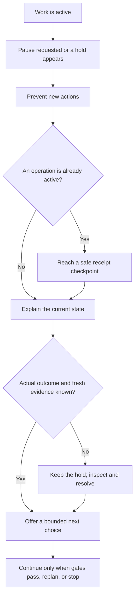

# Your first run, one clear step at a time

You bring the goal and the decisions. PatchCairn helps your assistant gather agreed evidence, explain the choices, and coordinate supported work. **Developed by Michael.** You can use ordinary language throughout; the assistant maintains the technical records.

## Start with the menu

Download the complete source ZIP from its publishing repository or reviewed release, extract it into a local folder you control, and open the folder containing `AGENTS.md` in a capable local assistant. Keep the included `.agents` folder. The [setup guide](GETTING_STARTED.md#1-download-and-extract-the-source) gives Windows, Linux, and macOS steps. A source-only copy excludes another person's `work/` records and approvals.

Codex is the primary workflow; other assistants need the [capability checks](ASSISTANT_COMPATIBILITY.md). An existing supported Python 3.12+ is needed for the portable helpers. A missing tool, permission, private-storage capability, or native adapter is explained before dependent work. A browser chat cannot be assumed to reach your local computer.

Copy this into chat:

> Read AGENTS.md and .agents/skills/pc-maintenance/SKILL.md from this project. PatchCairn: start. Show the menu and explain the choices. Wait until I choose a job and authorize its exact scope before collecting information.

Use the assistant's chat box, including the conversation inside a local assistant CLI. `PatchCairn: start` is not a PowerShell, Bash, or macOS Terminal command. The public website explains the route; it does not scan or operate your computer.

The menu starts **PatchCairn — Developed by Michael**. Bare Start and `PatchCairn: start` create no session and collect no host information. Choosing a job creates its record. The assistant then explains the selected scope and needs your actual authorization before assessment.

One assistant coordinates the session, records your decisions, and controls operations. Specialists can supply bounded research or independent reviews. You continue talking to the coordinator; you do not need to move records between assistants or edit JSON.

## Choose the job and say what matters

| Your goal | What is useful to tell the assistant | A request you can adapt |
| --- | --- | --- |
| **Security updates** | Which software or system area concerns you, whether an application must stay available, and any known compatibility requirement. It is fine not to know versions or technical details. | “Help me understand updates for the software we agree to check. I need my work apps available today. Assess first and show a plan before updating.” |
| **Storage cleanup** | The folders you want measured, files that must be kept, and whether you want metadata only or are willing to consider a separate content-read decision. | “Measure only the folders I select. Keep my browser data, saved chats, and unrelated projects out. Show candidates and recovery choices before moving anything.” |
| **Diagnosis and repair** | What you expected, what happened, when you noticed it, and a short nonsecret error if available. An observed recent change can be useful; you do not have to guess the cause. | “This app closes when I open a document. It worked yesterday. Diagnose the cause before proposing a repair; explain what remains uncertain.” |
| **Backup and recovery** | Exact files to include or exclude, the proposed destination, what must be recoverable, and whether the destination already contains anything important. | “Help me back up these selected files. Explain the contents, destination, storage needed, verification, and restoration limits before creating anything.” |

Do not send passwords, tokens, keys, raw private logs, or a whole computer inventory. If extra evidence is needed, the assistant should explain a narrow request first. Reading ordinary file contents for duplicates or backups is a separate decision from measuring metadata.

## Choose how closely to stay involved

**Guided** is a useful first choice: review the explanation at selected checkpoints. Its benefit is more opportunities to understand and decide; the tradeoff is more interruptions for your attention.

**Automatic within an approved policy** can continue unchanged routine work within exact authorized boundaries. Its benefit is fewer routine pauses; its tradeoff is needing carefully chosen scope, limits, recovery requirements, and stop conditions. It never bypasses a mandatory hold.

Choose timing separately: **now** or a **schedule proposal**. A proposed time is not a created schedule. Actual schedule creation requires a supported host scheduler and your authorization. A trigger cannot silently resume paused or stopped work, duplicate an outstanding operation, or grant maintenance permission.

Checkpoints cover scope, findings, the concrete plan, before actions, after actions, and the finish. A necessary restart is a separately explained decision. Changing settings invalidates affected plans and approvals; it does not widen old permission.

> I want guided work now. Pause after findings and before changes. Explain costs and recovery limits before I choose.

> PatchCairn: settings. Show my current scope, checkpoints, and timing. Explain the consequences before changing them.

## Follow the route from evidence to a decision

1. **Choose the job.** The menu helps you select the right kind of work.
2. **Agree the scope.** Identify exact selected information, folders, exclusions, and privacy limits. Authorize that assessment scope.
3. **Investigate.** Gather bounded evidence and relevant official information. Missing evidence stays unknown.
4. **Understand the findings.** Hear what happened, what it means, confidence, and the next useful check.
5. **Review a concrete plan.** See exact targets, benefits, drawbacks, known or unknown costs, reversibility, recovery requirements, verification, and any restart decision. Two independent reviews examine the change plan.
6. **Choose the work.** Approve the clearly identified plan or named part in ordinary language. Only supported, authorized work proceeds.
7. **Verify and finish.** Check the actual result, distinguish remaining concerns, and decide what records and recovery material to retain.

A useful approval is specific without being technical:

> Approve the plan you just showed for those selected files. Keep the recovery copy. Do not include the other folder or restart anything.

If several plans could match that instruction, the assistant needs to clarify which one. It records the identifiers itself; you do not need to copy a hash or edit JSON.

## If you need to pause, or something does not go to plan

The sequence in words: prevent new work, let an active operation reach a safe checkpoint, inspect what actually happened, and explain the next choice. An unknown outcome stays held. A resume request cannot supply missing evidence, and an elapsed wait is not proof of success.

| Say this | What to expect |
| --- | --- |
| `PatchCairn: pause` | No new actions. An active operation is recorded and brought to a safe checkpoint, without killing an installer during a write. |
| `PatchCairn: status` | Completed work, active work, unresolved items, and whether you need to do anything. |
| `PatchCairn: options` | Meaning, benefits, drawbacks, costs, reversibility, and a recommendation for the current choice. |
| `PatchCairn: cost` | Supported estimates from known facts and explicit unknowns. No invented price, time, or guaranteed reclaimed space. |
| `PatchCairn: resolve` | An explanation of an identified pending item and the evidence or decision it needs. No blind retry or unsupported success claim. |
| `PatchCairn: resume` | Fresh checks of scope and actual outcomes before continuing. Text alone cannot clear a hold. |
| `PatchCairn: stop` | The session ends while evidence and unresolved work are preserved. A late result can still be recorded, but the stopped session stays stopped. New work needs a new reviewed session. |
| `PatchCairn: help` | A plain-language explanation of commands and the workflow. |

## Common interruptions and difficult cases

“Held” means the dependent action cannot proceed safely or with its current authority. It is useful information, not an invitation to weaken a check. Other independent work can continue only if it remains supported, authorized, and unaffected.

| Situation | What it means | What PatchCairn does | Your choices and recommendation | Cost and way back |
| --- | --- | --- | --- | --- |
| **Power loss, restart, or closed assistant** | An operation may have completed, failed, or changed only part of its target. | Preserves available intent and receipts; reconciles actual state before further work. A missing receipt remains unknown. | Reopen the same source copy and ask for status, then resolve. Avoid repeating the last installer or move. | Rechecking takes time and may use assistant quota. Rollback depends on verified recovery; interruption does not prove nothing changed. |
| **Network unavailable** | Official research, a download, or a remote check cannot finish. | Explains the affected evidence gap and holds dependent source or change decisions. | Restore access through normal means, defer that item, or review unaffected offline work. Do not substitute an unofficial download. | More attempts can use time, bandwidth, and quota. An earlier download or partial operation may remain; its state must be checked. |
| **Not enough free space** | Records, a backup, a verification copy, or an installer cannot fit. | Holds dependent work, retains available receipts, and checks for partial output. It does not run a global cleaner. | Review measured space, narrow the selection, or choose a supported destination and revised plan. | A backup and restoration check require storage. Quarantine moves on the same volume free **no disk space**; permanent removal is a separate decision. |
| **A required tool is missing** | The selected route cannot run with available capabilities. | Explains the missing requirement and supported alternatives; does not silently install it. | Defer, select an existing supported route, or separately review an official installation. | Downloads, storage, licensing, setup time, or restart costs may apply; unknown amounts remain unknown. Installing a prerequisite is a real change. |
| **Permission, sign-in, or OS consent is needed** | A normal access boundary or protected prompt needs the owner. | Holds the dependent step and explains which prompt or selected access is expected. It never bypasses security or repairs permissions to force progress. | Handle the legitimate prompt yourself, choose a supported private workspace, narrow scope, or defer. Never paste a secret into chat. | Your attention is required. Declining consent keeps that step held; it does not roll back earlier completed work. |
| **Publisher or installer identity cannot be verified** | The package may be wrong, altered, or insufficiently proven for the exact target. | Refuses the handoff until actual content, package identity, publisher, version, and variant match the reviewed plan. | Obtain a verified official artifact and a new review, or leave the item unchanged. Do not disable protection to accept it. | Verification or a fresh download adds time and bandwidth. A hash alone cannot establish publisher ownership. |
| **A selected file changed, or evidence is stale** | The plan no longer describes the current target or conditions. | Holds the action and requests fresh selected evidence; material changes invalidate affected approvals. | Stop editing that selection while it is checked, narrow the scope, or review a replacement plan. | Reassessment uses time and quota. A new approval cannot retroactively undo an earlier action. |
| **An outcome is unknown or partial** | Some effects may exist, and success has not been established. | Keeps the consumed action and its history; inspects exact evidence without automatically retrying. | Ask for status and resolve. Choose recovery or a new plan only after the observed state is explained. | More investigation may be needed. Recovery is uncertain until checked; do not delete receipts or backups. |
| **Another operation is still busy** | An outstanding operation must be accounted for before conflicting work can start. | Keeps the registered coordinator's operation boundary occupied, including paused or stopped work awaiting its result. | Wait, inspect its status, or stop future work. Do not launch a second assistant to repeat the action. | Waiting time is unknown. A pause or stop cannot erase effects of work already active. This coordination is not an OS-wide lock against unrelated programs. |
| **The filesystem cannot support a required safe operation** | Private records, identity checks, or a no-overwrite move cannot be established on that location. | Holds before dependent private writes or effects. It uses no copy/delete or permission-bypass fallback. | Choose a supported owner-controlled private location, narrow the job, or defer. Do not promote or silently migrate an old run to another backend. | Relocating planned work can need storage and fresh review. No data movement is implied by selecting a new location. |
| **Backup or restoration verification fails** | Required recovery is not established, even if an archive exists. | Preserves artifacts and holds changes that require them. It does not label the backup usable from a success flag. | Reduce the selection, review another supported recovery route, or defer the change. Keep original files and evidence. | Repeating a separately reviewed attempt needs time and storage. An archive is not encrypted, and file-content backup is not system rollback. |
| **Quarantined files have no exact verified original backup** | Moving them was reversible under its own checks, but integrated permanent removal lacks required coverage. | Can review a supported exact-file restoration. Integrated purge remains held without the exact original backup, manifest, and restoration-probe binding. | Prefer restoration or retention. A quarantine approval does not approve permanent loss. | Retention still uses space. Permanent purge is irreversible and also needs a separate exact permanent-loss acknowledgment. |

## Know the current boundaries before committing

The built-in content backup route is small and selected: **16 MiB per file, 48 MiB total selected content, and a 64 MiB archive**. Its metadata limits and protection checks also apply. Larger content needs a narrower selection or a separately reviewed supported backup approach; PatchCairn does not silently raise those caps. A ZIP is not encrypted and is not an operating-system image.

Current integrated update handoffs cover one exact reviewed **local Windows MSI, macOS PKG, or Linux DEB** artifact, with a **64 MiB per-artifact proof cap**. They require the supported stable variant, exact package identity, official provenance, publisher/signature and package-metadata evidence, compatible installation scope, fresh checks, plan reviews, and actual authority. The assistant performs only the approved fixed official host call with normal OS consent; issuing the handoff itself runs no installer. A common EXE installer, a larger package, or a different installer argument is not an interchangeable route.

Package-manager update routes and OS/application repair routes remain held in the current integration. A vendor-supported procedure may still be a useful recommendation: the assistant can explain the official tools, practical risks, recovery requirements, and a concrete owner-performed step. This guidance is not an integrated execution route. It cannot authorize an arbitrary command around a held adapter or turn a recommendation into a completed update or repair. Assessment and diagnosis can finish with a clear account of findings, unavailable capabilities, and the next choice.

For the supported Windows MSI route, an installer can report **installed, restart still needed** (code 3010). PatchCairn keeps that original receipt and the same unfinished operation. You choose to defer or separately authorize an owner-handled restart after saving your work; update approval does not supply restart approval. The assistant accounts for the actual boot transition, selected installation, and original behavior afterward. Final success requires the reviewed target and all behavior checks to pass. Failed or partial results stay truthful and need reconciliation before a new recovery or change plan. It does not rerun the installer, translate the code to zero, or restart Windows itself. Pause stays in effect for later work. Even after stop, you may make only the exact restart decision needed to account for that retained operation's unfinished effect; the session stays stopped and starts no new action. Missing decision or boot evidence keeps the same operation unfinished.

Actual platform, private-storage, and native-tool checks can hold any dependent route. Read [platform support](PLATFORM_SUPPORT.md), [service integration](SERVICE_INTEGRATION.md), and the [official tool catalog](TOOLS.md) when choosing it. These references distinguish implementation, observed fixture evidence, and platform limits.

Authentication, protected OS consent, missing required recovery, stale evidence, uncertain outcomes, unsupported capabilities, and new material scope never become automatic merely because you selected automatic control or a schedule.

## Finish with an answer you can use

Ask for what completed, how it was verified, what remains unknown, and the next useful choice. A matching installed version, verified application behavior, and a resolved security concern are separate findings.

If you wanted assessment only, ask for the findings, limitations, and assessment-only closeout. An eligible session can complete after its agreed assessment stages, a scope-bound summary, a separate check of evidence coverage and limitations, and your actual closeout decision. A selected finish checkpoint still waits for your continue decision. The result means the assessment is recorded with no maintenance action in that session. It does not establish that the whole computer is secure or that nothing outside the session changed.

Existing plan or operation history can make the session ineligible for that assessment-only route. The assistant must follow its actual closure rules and explain what remains. You can stop further work while preserving findings and unresolved outcomes. It must not invent an action, bypass a gate, or count deferred changes as completed to obtain a different status.

Keep the records and recovery material you need. The current service has no general session-deletion or required-retention-release executor. The assistant checks each proposed cleanup against the exact component that created the files; another helper's housekeeping permission cannot substitute. Retain anything whose supported cleanup path, required protection, or actual outcome remains unresolved. Any supported later cleanup should show exact files, sizes, and what would be lost. Private records stay under the source copy's owned `work/` directory and must not appear on the public website. Deleting them does not undo updates or erase the host's own logs.

See [getting started](GETTING_STARTED.md), [common questions](FAQ.md), and [recovery and cleanup](../RECOVERY_AND_CLEANUP.md). Use a fresh session for a new task, with fresh scope and decisions.
